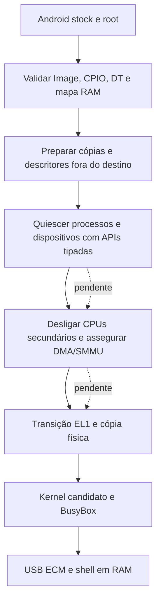

# Arquitetura e limites

## Caminho pretendido

O loader atual possui bloqueio CFI antes de caminhos dependentes de símbolos
privados. A cadeia acima é o objetivo, não uma sequência funcional validada.

## Layout selecionado

| Objeto | Endereço/limite |
|---|---|
| Janela de exclusão | `[0x90000000,0x93400000)` |
| Entrada com offset0 | `0x90000000` |
| Entrada com offset0x80000 | `0x90080000` |
| image_size do candidato | `0x2b20000`; fim `0x92b20000` |
| Initramfs | início `0x93000000`, até2MiB |
| DTB | início `0x93200000`, até2MiB |

O protocolo ARM64 exige base2MiB alinhada mais text_offset, região image_size
disponível, DTB alinhado e restrições de localização do initrd. O helper C
valida os offsets suportados e os limites antes de somar/arredondar.
O verificador host também examina recursos reservados aninhados e reservas DT.
O walker RAM do módulo, sozinho, só verifica o recurso pai. Nenhuma dessas
checagens reserva a janela contra a alocação ou DMA do Android em execução.

## Interfaces CFI

Chamadas diretas exportadas e callbacks oficiais com protótipos corretos são
usados onde disponíveis. CFI continua estrito; SCS reserva x18. Funções de
assembly que retornam preservam x18/LR no frame de96 bytes. Presença de
`__cfi_check` comprova instrumentação, não a validade de todos os destinos
indiretos ou do protocolo de shutdown.

18 referências privadas restantes foram inventariadas em auditorias. Algumas
envolvem freezer, machine_shutdown/restart, modos de CPU, kexec e QMP.
Obter um endereço via kallsyms não torna uma chamada indireta válida em CFI.
Os protótipos existentes não constituem um backend operacional liberado.

## Ordem de desligamento

kernel_restart passa por notifier, device_shutdown, migração ao CPU de reboot,
syscore_shutdown e machine_restart. O retorno do notifier não cancela a cadeia.
O restart handler final ocorre com contexto inadequado para operações que
dormem, como hotplug. syscore mantém mutex próprio e já vê drivers desligados;
arm_smmu_device_shutdown chama remove na fonte analisada. Não há prova de que
o teste de CPU1 durante Android normal possa ser repetido nesse ponto tardio.

## Guard WARM

O guard altera somente a variável exportada reboot_mode quando o estado é
COLD; não chama firmware nem reboot. O controlador solicita adb reboot à parte.
Não usa force_warm_reboot privado. WARM seleciona caminhos SCM/PSCI conforme
a fonte, mas suporte/fallback e handler efetivamente consumido não foram
observados. Com panic_mode indefinido, a política pode afetar o fallback panic.
A comparação de valor no unload não detecta ABA de outro escritor idêntico.
O guard não é um mecanismo de logging ou um backend kexec.
